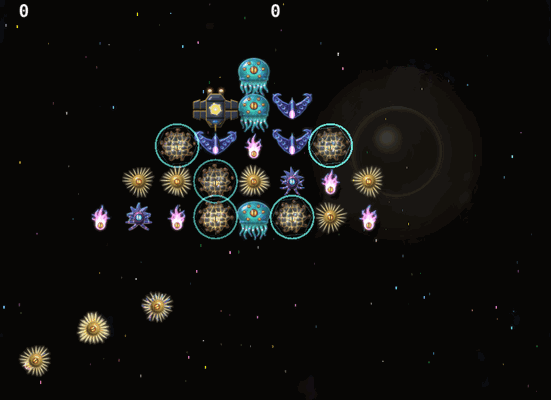
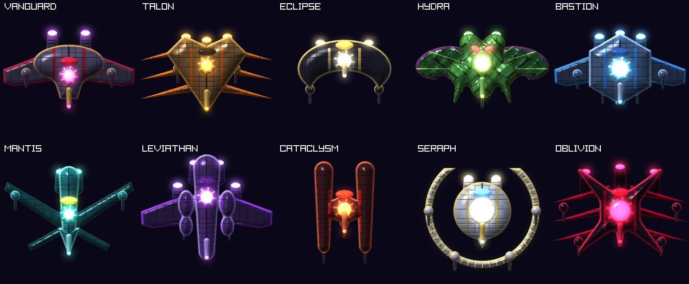
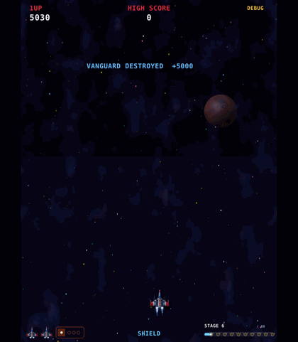

# Star Swarm
*Ten sectors. Ten capital ships. One pilot.*

Star Swarm is a fast arcade shooter inspired by the classic formation shooters of the '80s. Every ship, monster, asteroid and explosion is generated by the game itself at startup, with no art files. Lighting, shadows and glow effects give each one a detailed, 3D-like look.

Fly through 60 stages across 10 sectors. Each sector brings four alien waves, a dense meteor field, and a boss battle against a towering capital ship. After each boss, tear open a hyperspace window and dive through to the next sector.

## Features

- **A living space bestiary:** Nova Urchins, Void Mantas, Nebula Jellies, Comet Imps, Asteroid Brutes and Cosmic Leviathans. Each one is fully animated, swoops in along its own flight path and dives at you.
- **Ten capital-ship bosses:** each is armoured, covered in detail and has a beating reactor core. Every boss is tougher than the last, with signature weapons such as spiral barrages, homing missiles, sweeping lasers and meteor storms.
- **Meteor fields:** tumbling asteroids split apart as you shoot them, and volatile rocks set off chain reactions. Mining outposts drift through, carrying supplies for anyone who blasts them free.
- **Five weapon classes:** Photon Torpedo, Spread Cannon, Pulse Laser, Homing Swarm and Ion Burst. Armoured Courier ships carry new weapons and upgrades, each weapon goes up to Lv3, and a max-level upgrade calls in a wingman drone that dodges fire at your side.
- **A ship that feels alive:** your fighter banks into turns, fires its side thrusters and warps in on every respawn. It's protected by a one-hit force field that recharges over time.
- **Arcade at heart:** high scores, extra lives, a campaign progress bar, and one goal: destroy all ten capital ships and save the galaxy.

## Play

Download the latest build from **[Releases](https://github.com/GiladGlo/StarSwarm/releases/latest)** (Windows 64-bit, nothing to install). Each release lists SHA-256 checksums so you can verify the download. The build is not code-signed, so Windows SmartScreen may show a warning on first run. If you'd rather not run a downloaded exe, you can build it from source using the instructions in [Code/README.md](Code/README.md).

| Key | Action |
|---|---|
| Arrows / WASD | Move |
| Space | Fire (hold) |
| P / Esc | Pause (Esc opens the menu) |
| M | Mute / unmute music |
| F11 / Alt+Enter | Fullscreen |

Full gameplay details, scoring and build instructions: [Code/README.md](Code/README.md).

## How it was built and tested

Star Swarm was built with Claude as an AI pair programmer, and nearly every commit is co-authored with it. I defined what the game should be and how it should feel; Claude helped design and implement each feature.

QA ran on every change. After each change, Claude built the game, ran it, and checked screenshots and logs to confirm the new behaviour worked and nothing else had broken, before the change was committed.

*Written in C++ with raylib. Runs as a single Windows executable with nothing else to install.*

## License

[MIT](LICENSE)

Developed by Gilad Globen. Dedicated to Daniel Globen.
